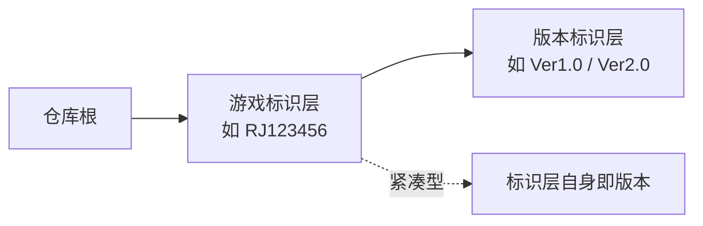

# SakuGame 用户手册（Wiki）

> 面向使用者的操作手册与排障手册，由 AI 维护；发布时如有新增设置项或常见问题，同步补入本文件。
>
> - **适用版本**：0.2.0 起（`0.2.0` = MVP v1 / v1.1 / v2 / v2.1 全部能力；实际版本号以应用「关于」页为准）
> - **最后更新**：2026-11-21
> - **技术细节**不在此展开，见 `DSPlans/Specs/` 下各版本技术规格

---

## 一、安装与部署

### 系统要求

| 项目 | 要求 |
| --- | --- |
| 操作系统 | Windows 10 / 11（x64） |
| 运行库 | WebView2 Runtime（Win11 自带；Win10 如缺失需安装） |
| 游戏仓库 | 任意可被系统访问的路径：本地盘、NAS 共享（盘符映射 / IP / 主机名均可） |
| 缓存盘 | **建议 SSD**。游戏从仓库复制到缓存盘后运行，HDD 仓库不参与运行 |

### 运行方式

- **绿色版**：双击 `SakuGame.exe` 直接运行，无需安装。
- **安装包**：`msi` / `nsis` 安装后从开始菜单启动。

### 数据存放位置

所有应用数据都在一个目录里：

```
%APPDATA%\com.saku.sakugame\
└── sakugame.db          SQLite 数据库（另有 -wal / -shm 两个伴生文件）
```

**该目录记录你的全部配置**：仓库路径、手填的名称 / 编号 / 封面、缓存池配置、搬运任务、变更组记录。**游戏本体与存档不在这里**，它们始终在仓库（NAS）与缓存池里。

> 备份建议：换机或重装前，复制整个 `com.saku.sakugame` 目录即可。删除该目录等于恢复出厂设置（需重新扫描仓库并重新手填信息）。
>
> 注意：如果卸载时勾选了「删除应用数据」，上述配置会被清掉，但**仓库与缓存池里的游戏文件不受影响**。

---

## 二、首次使用

整体流程只有三步：**配仓库 → 扫描 → 玩**。


### 第 1 步：添加仓库路径

进入 **设置 → 仓库管理 → 添加路径**。

| 字段 | 说明 |
| --- | --- |
| 盘符路径 * | **必填**。例如 `Z:\Game` |
| IP 路径 | 可选。例如 `\\192.168.1.10\资源盘\Game` |
| 主机名路径 | 可选。例如 `\\nas\资源盘\Game` |

三个定位项指向**同一个仓库**的不同访问方式。检测与扫描时按 **盘符 → IP → 主机名** 的顺序依次尝试，第一个可达的即被采用——这样盘符掉映射时能自动回落到 IP，NAS 改了 IP 时能回落到主机名。

### 第 2 步：扫描

在仓库条目上点 **扫描**。扫描中可 **暂停 / 继续 / 取消**，暂停会落断点，可以晚些继续。

扫描完成后会提示：`新增 X，更新 Y，缺失 Z，警告 N`。

- **新增 / 更新 / 缺失**：缺失指仓库里已找不到对应目录，档案会灰显，但**不会被删除**（你手填的信息仍在）。
- **警告**：见下方「扫描告警」一节。

重复扫描是安全的：**只刷新大小与状态，绝不覆盖你手填的名称、编号、封面、备注与启动项配置。**

### 第 3 步：主页浏览

主页是卡片墙：封面、编号角标、版本数角标。缺失的档案灰显且不可点击。

进入详情页后可编辑名称与编号（点 ✎），点封面右上角可更换封面。

---

## 三、仓库怎么组织（影响识别效果）

程序按「**游戏标识层 / 版本标识层**」两层理解仓库：



| 形态 | 长什么样 | 识别为 |
| --- | --- | --- |
| **标准型** | `<仓库根>/RJ123456/Ver1.0/game.exe` | 一个游戏（RJ123456）+ 多个版本 |
| **紧凑型** | `<仓库根>/RJ123456/game.exe` | 一个游戏 + 单个版本 |

**判定规则（要点）**：

- 目录的**直接子文件**里出现可执行文件（或压缩包）才算一个版本；埋在更深的子目录里不算。
- 同时有 exe 和压缩包时，按**文件夹型**处理。
- 安装器 / 卸载器 / 崩溃报告 / vcredist 之类的工具 exe 会被排除，不会误判为版本。

> **不按规范组织也能建档**，只是失去自动识别多版本的便利——那种情况下可以用详情页的「手动新建版本」兜底，启动项可以指向版本目录下任意更深的位置。

> **压缩包不支持**：`.zip` / `.7z` / `.rar` 等压缩包形态**不参与搬运**（会提示「请先在仓库中解压后重扫」）。这是有意为之——解压搬运与存档回写会让变更组变得不可靠。请先在仓库里解压。

### 扫描告警怎么看

扫描结束后，设置页会列出上一次扫描的告警明细。它们**不阻断建档**，但提示仓库结构有问题：

| 告警 | 含义 | 建议 |
| --- | --- | --- |
| 仓库根目录下有 N 个散落文件 | 那些文件不在任何游戏目录里，未被识别 | 把游戏放进子目录 |
| N 个目录因自身含可执行文件被截断 | 该目录被当成「紧凑型游戏」，其子目录未参与版本识别 | 若该目录本该是多版本游戏，需调整结构或用「手动新建版本」 |
| N 个目录枚举失败 | 权限 / 长路径 / 网络问题 | 检查该目录是否可访问 |
| N 个版本的 `.SakuAnchor.json` 写入失败 | 仓库只读、网络异常或权限不足 | 该版本无法用锚点定位，会退回按仓库路径查找；建议给仓库写权限 |

---

## 四、缓存池配置

缓存池是**存放「当前要玩的游戏」的本地副本区**。游戏从仓库复制到这里运行，全程不再依赖 NAS。

配置位置：**设置 → 仓库管理 → 缓存管理**。

### 路径要求

- 必须是本地盘，**强烈建议 SSD**。
- **不得设在任何仓库根之内**（否则等于把缓存写回 NAS，失去意义）。
- **一旦池内有缓存或存在搬运任务，路径即被锁定**。要改路径必须先清空缓存池（把池内游戏逐个移出）。

### 容量

- 容量是**逻辑配额，不预分配磁盘空间**——填 400 GB 不会立刻占用 400 GB。
- 默认 10 GB。按你的游戏体量改，界面会算出可设范围：
  - **下限** = 已用（不能缩到比现有缓存还小）
  - **上限** = 已用 + 物理可用（物理可用 = 盘剩余 − 盘总容量的 10% 安全线）
- **扩容有安全线**：扩到的新配额必须让磁盘至少留出「盘总容量 10%」的余量，防止把系统盘塞满。

### 容量怎么记账

```
已用 = 已完成缓存的游戏 + 在途任务（含预留）
```

也就是说，**开始搬运的那一刻配额就被占住了**，不必等搬完。取消或失败会归还配额。

界面上会显示：环形占用图、已用 / 配额、剩余配额、盘剩余、安全线、可用。环形图旁边的两个数是不同的东西——**「剩余配额」是逻辑上限，「盘剩余」是物理事实**。

> 容量满了怎么办？程序**不会自动淘汰**任何游戏。这是设计选择：移出缓存需要你确认哪些存档变动要回写，机器替不了。届时会提示配额不足，请到详情页把某个游戏**移出缓存**（见第七节），或调大容量。

---

## 五、搬运与启动

### 前置：先配启动项

搬运和启动都要求该版本**已配置启动项**（可执行文件）。详情页 → 版本卡片右侧 **⚙ 配置** → 在「启动项（可执行文件）」里选一个。

- 列表来自扫描结果，安装器 / 卸载器类已被过滤。
- 找不到合适的？可用「手动添加可执行文件」指向更深的位置。
- 没配启动项的版本在卡片上会标「未配置启动项」。

### 搬运

在详情页点主按钮（**搬运**）。它会先做**容量预检**：

| 预检结果 | 含义 |
| --- | --- |
| 缓存池未配置 | 先去设置里填池路径 |
| 配额不足 / 卷空间不足 | 见上节「容量满了怎么办」 |
| 该版本已缓存 | 无需重复搬运 |
| 压缩包未就绪 | 该版本是压缩包形态，需先在仓库解压再重扫 |

预检通过即开始搬运。搬运过程中：

- 进度、速率、ETA 实时显示，可 **暂停 / 继续 / 取消**。暂停在文件边界生效；继续会跳过已完成文件续传。
- 并发不是固定值：全局上限 32 个文件通道，按本次待搬文件数自动定档（4 / 8 / 16 / 32）。
- 先写入 `.staging` 临时目录，校验（文件数 + 总字节 + 逐文件大小）通过后才原子改名落地；单文件失败会自动重试 2 次，仍失败会列出失败清单。
- **程序中途退出**：未完成的任务在下次启动时转为「暂停中」，点继续即可续传。

搬运页（左侧导航「搬运」）按状态分页签查看全部任务：搬运中 / 排队中 / 暂停中 / 出错 / 完成，并支持批量操作。

### 启动

搬运完成后，详情页主按钮变为 **启动**。

- 游戏从**缓存池路径**拉起，**全程不依赖仓库可达**——NAS 断电、断网都不影响。
- 工作目录已设为可执行文件所在目录（兼容需要相对路径读取资源的游戏）。
- 游戏进程不被程序跟踪：程序的视角里，点了启动就等于交给你了。

---

## 六、存档与变更组（重要）

这是这套程序最需要理解的一节。**缓存池里运行游戏产生的改动（存档、配置、补丁），不会自动写回 NAS。**

### 变更组是什么

程序在版本目录下维护一个 `SakuAlter` 文件夹，里面分两组：

| 组 | 位置 | 内容 |
| --- | --- | --- |
| **BG**（游戏本体） | `SakuAlter/BG/` | 你在缓存池里改动的**游戏本体文件** |
| **UD**（用户目录） | `SakuAlter/UD/` | 你指定的**用户路径**下的文件（存档通常在游戏目录之外） |

搬运完成时会发生两件事：

1. **注入**：如果 `SakuAlter/BG` 或 `SakuAlter/UD` 里已有文件，它们会被覆盖到缓存池的对应位置——这样上次玩到哪、改过什么，搬过来就还原了。
2. **记录基线**：为缓存池内的全部文件记一份 mtime / 大小快照，作为「哪些文件后来被改过」的对照基准。

### 用户路径：存档在哪，你得告诉它

绝大多数游戏的存档**不在游戏目录里**，而在类似这些位置：

```
C:\Users\<你>\AppData\LocalLow\<厂商>\<游戏>
C:\Users\<你>\Documents\...
```

程序无法可靠地自动猜出这些路径（不按引擎匹配、不按后缀扫描）。所以需要你**手动填写一次**：

> 详情页 → 版本卡片 **⚙ 配置** → **用户路径（绝对路径）**

- 必须是绝对路径，且目录必须存在。
- 不填也能用，但 `SakuAlter/UD` 里的内容**不会**被注入，你那些存档的变动也**不会被回写**。
- **关键安全行为**：如果 `SakuAlter/UD` 里已经有文件、而你的用户路径没配或不可达，搬运会**报错并回滚**，绝不静默跳过——宁可不搬，也不悄悄丢掉你的存档。

### 移出缓存（把改动写回 NAS）

玩法结束后，如果想把空间腾出来，就在详情页点 **移出缓存**。流程是：


**检测怎么判定**（两侧口径不同，这是有意的）：

- **游戏本体**：以基线为准。自搬运后没动过的文件一律不回写（本体在 NAS 上本来就是你搬来那份）。
- **用户路径**：以「是否已经在变更组里」为准。`SakuAlter/UD` 里还没有的文件一律列出来——因为存档可能在任意位置、任意名称，宁可多问你一次。

**勾选对话框里要注意**：

- **红色标注「自动回写」的文件不可取消**——这些是变更组里已有、且内容已经变了的文件（比如旧存档被覆盖），必须回写才不丢进度。
- 其余文件默认全选，可以取消。**底部那句「未勾选的新增文件将直接丢弃」是真的**：没勾的文件会随着删除池内副本一起消失。
- 点**取消 / 叉号**：任务转为暂停，游戏与存档原样保留，什么都不会发生。
- 用户路径下的文件如果特别多（超过 5000 个或 512 MiB），列表只会显示「自基线变动过」的文件，并注明省略了多少——避免把整个用户目录都列出来。

**写回是安全的**：

- 先把选中的文件提取到缓存池的 `.waiting` 暂存区并记录清单，**再**删池内副本，**最后**才写入 NAS 的 `SakuAlter`。
- 写回过程中程序崩溃 / 断电：下次启动会读 `.waiting` 里的清单**自动续写完成**。
- 检测完成后停在「待确认」阶段时程序退出：该任务会被置为已取消（游戏仍在池内，什么都没写入），重新点一次即可。

### 回写与搬运谁优先

回写和搬运共用同一套并发额度（32 通道）。**回写优先**：如果回写排着队而搬运占满了额度，搬运会被暂停（复用「暂停」状态）以给回写让路。回写结束后，被抢占的搬运任务**不会自动恢复**，需要你在搬运页手动点继续。

### 锚点：游戏文件夹被移动了怎么办

程序会在版本目录里生成 `.SakuAnchor.json`（锚点），记录这个版本的唯一标识。它的作用：

- 你把游戏文件夹在 NAS 里挪了位置 → 点搬运时找不到旧路径 → 程序会去各仓库两层目录里找锚点，找到就自动更新路径，**不需要重新扫描**。
- 锚点被误删 → 只要路径可达，扫描时会自动重建。
- 锚点写入失败（仓库只读）不会阻断建档，但会失去上述自动重定位能力。

---

## 七、黑名单

删除档案或版本时，对应路径会进入**黑名单**，这样下次扫描不会又把它扫回来。

**设置 → 黑名单**：

- 按游戏标识层折叠显示，条目分「档案 / 版本」两类。
- 点 **取消拉黑** 会**立即恢复**（档案回主页、版本回所属档案），不必等下一次扫描。
- 但**已丢弃的手填数据不会恢复**——名称、编号、封面、版本配置在删除时就没了。

> 删除只是删数据库记录与黑名单登记，**不会删除仓库里的游戏文件**，也不会删 `SakuAlter` 目录（存档是你的资产，程序一律不碰）。

---

## 八、故障排查

| 现象 | 可能原因 | 处理 |
| --- | --- | --- |
| 提示「仓库路径全部不可达」 | 盘符未映射 / NAS 关机 / IP 或主机名变了 | 点仓库的「检测」看实际可达性；补上 IP 或主机名定位项 |
| 扫描后游戏少了 | 目录结构不符合两层规范，或目录被截断为紧凑型 | 看扫描告警；用「手动新建版本」兜底 |
| 某个游戏灰显（缺失） | 仓库里已找不到该目录 | 检查是否被改名 / 移动。它不会被删除，手填信息仍在 |
| 提示「该版本尚未配置启动项」 | 没选可执行文件 | 详情页 ⚙ 配置 → 选启动项 |
| 提示「压缩包形态暂不支持搬运」 | 该版本是压缩包 | 在仓库里解压后重新扫描 |
| 提示「缓存池配额不足」 / 「卷空间不足」 | 池满了或物理盘满了 | 移出某个池内游戏，或调大容量（注意 10% 安全线） |
| 缓存池路径无法修改 | 池内有缓存或有在途任务 | 先把池内游戏全部移出缓存 |
| 提示「缓存池路径不得设在任何仓库根之内」 | 池路径填到仓库里了 | 换到本地盘 |
| 启动失败：「可执行文件不存在，缓存可能已被清理」 | 缓存池里的文件被外部删了/移走了 | 重新搬运（程序启动时会做对账，把丢失的缓存标记为缺失） |
| 启动失败：「路径超过系统 260 字符限制」 | 缓存池路径 + 相对路径过长 | 把缓存池设在更短的路径下（例如 `D:\Cache`） |
| 移出缓存时提示找不到路径 | 游戏文件夹在 NAS 里被移动且锚点不可用 | 重新扫描仓库，或用详情页的「单档案重扫」 |
| 用户路径保存失败 | 不是绝对路径，或目录不存在 | 填完整的绝对路径，确认该目录此刻可访问 |
| 搬运报错「变更组注入 / 初始记录失败」 | `SakuAlter/UD` 有文件但用户路径没配 / 不可达 | 先配置正确的用户路径，再重试搬运（缓存池内容会保留，可直接重试） |
| 搬运被暂停了但自己没点暂停 | 回写优先调度抢占 | 到搬运页手动点「继续」 |
| 扫描很慢 | HDD 随机寻道 + 每版本写锚点 | 属正常；已对已有锚点的版本跳过重扫（仅标准型）。可用「暂停」分批 |

### 关于性能

- 扫描只下探两层，不递归；真实仓库 240 个目录约十几秒。
- 搬运速度受限于 NAS 上的 HDD 随机寻道——这是本程序存在的理由，不是缺陷。
- 基线记录与检测只做 stat 与哈希，不读全文件内容。

---

## 九、升级与数据

- **升级不需要手动操作**：数据库结构变更在启动时自动完成（按列探测逐项补齐，任意旧版本都能升到当前）。
- **手填数据不会丢**：名称、编号、封面、备注、启动项配置在升级中保持不变。
- **重新扫描是安全的**：幂等重扫只刷新客观字段，绝不覆盖你手填的内容。
- **唯一会清空数据的情况**：从很早的开发期构建（v1 数据库结构）升级时，业务表会被清空重建——这种情况需要重新扫描仓库并重新手填信息。
- **`SakuAlter` 永远不被删除**：删除档案 / 版本 / 仓库、黑名单、移出缓存，都不删 `SakuAlter` 目录。它是你的存档资产，程序只往里写，不往外删。

---

## 十、反馈

反馈时请附上：

1. **版本号**（设置 → 关于 页可见）
2. **操作步骤**（点了什么、当时在做什么）
3. **截图或错误提示全文**（错误提示里通常带具体数值，很有用）

如果能说明「游戏是标准型还是紧凑型」「是否配了用户路径」「缓存池容量」，定位会快很多。
