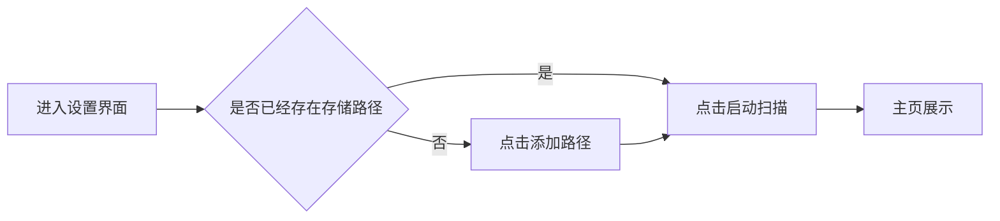

## 1、MVP v1实现目标

## 2、 功能实现

1. 多仓库路径配置功能
	- 用户在哪用到它：设置 - 存储界面中，用户选择“添加路径”来增加一个仓库扫描条目
	- 要看到什么：
		- 添加路径的按钮
		- 修改、删除路径的按钮。
	- 要能做什么：
		- 添加路径的按钮：用户点击后可以输入一个仓库的存储路径
		- 修改、删除路径的按钮：用户点击后可以对这个存储路径进行修改和删除
			- 修改：
				- 边界：不允许输入NULL，当用户输入NULL且点击确认修改后，则不进行任何修改（即视为非法输入，但是不提醒，只做丢弃）
				- 风险：修改仓库路径后，需要提醒用户该仓库下的所有档案的源路径均会被引用到新的仓库路径位置。用户确认后，则修改该仓库下的所有档案的源路径引用（但是这里应该可以通过一个变量直接传递，不需要挨个修改，即档案记录的是相对路径，拼接上源路径后等于绝对路径）
			- 删除：
				- 风险：点击删除按钮后，需要提醒用户该仓库下的所有档案均会被删除，用户确认后，则删除掉该仓库下的所有档案记录

2. 自动扫描可执行文件功能
	- 用户在哪用到它：
		- 设置 - 存储界面 - 路径条目 - 扫描按钮：用户点击后启动扫描
		- 设置 - 存储界面 上栏：显示UI
	- 要看到什么：
		- UI：显示扫描进度N/M，扫描进度条，当前正在扫描的游戏
		- 扫描的按钮的三种状态：启动、暂停、取消
	- 要能做什么：
		- 点击扫描按钮后，触发扫描逻辑，开始扫描文件夹，且在UI上显示进度

3. ~~指纹功能（经讨论认为不合适）~~
	- 用户在哪用到它：
		- 扫描文件时，对游戏进行建档
	- 要看到什么：
		- 对用户透明
	- 要能做什么：
		- 用于快速辨识游戏，防止在游戏文件夹名称修改后丢失
	- 争议点：
		- 我突然意识到，“防止在游戏文件夹名称修改后丢失”这个目的并不成立。原因在于，在一般情况下，一个屯屯鼠的命名习惯是相对固定的，也就是说在他存入仓库的那一刻起，该文件夹被改名的概率极低
			- 而为了一个极低的应用场景去建立一套指纹是极其不划算的。
			- 这个功能也有更好的替代方案，但是不是mvpv1做的内容：当用户点击开始游玩->发现找不到游戏时则提醒用户找不到执行目录->对该档案单独执行一次重扫/重新指定目录
		- 但是指纹功能也是有用的，用处在于MVP v3中对存储进行管理，此时需要辨认已被修改的文件与未被修改的文件。
		- 综上所述，指纹不作为v1的实现对象

4. 建档功能
	- 用户在哪用到它：
		- 设置 - 存储界面 - 路径条目 - 扫描按钮
		- 主页浏览
		- 详情页浏览
	- 要看到什么：
		- 游戏文件夹/压缩包在仓库路径下的相对路径
		- 游戏文件夹/压缩包大小
		- ※游戏编号
		- 游戏名称（初始时等于游戏文件夹名称）
		- ※游戏封面（带※表示当前阶段由用户自行配置，不要通过扫描自动建档。且未配置的封面显示为占位图，占位图显示游戏文件夹名称）
	- 要能做什么：
		- 用于记录游戏基础本地信息
		- 用户可以修改游戏名称、游戏封面、游戏编号
			- 【注意】
				- 不做例如tag、评分等高级元数据内容，mvp v1只实现最基础的游戏信息建档
				- 游戏编号：这个属于在线元数据的内容，但是我的习惯是记录游戏编号，（即作为某种意义上的主键使用），因此这里提前引入游戏编号。但是**禁止**自动扫描，哪怕我本地文件夹全是游戏编号。
					- 游戏编号只能由用户手动配置，且可以为空

## 3、UI规划

1. 导航栏组成
	- 整体切分为左侧边栏、上边栏与右侧显示区域
	- 左侧边栏：顶部显示SakuGame,下边显示主页、设置
	- 上边栏：不做任何内容，只用于占位
		- 原因：上边栏未来是要留给搜索，但是mvp阶段不做搜索这个功能，也不做搜索框
		- 因此上边栏只用于占位，不显示任何内容

2. 主页显示规划
	- 主页以卡片样式进行显示。
		- 卡片大小固定，在全屏窗口下显示5列（行数待定，需要具体测量），在缩放窗口下自适应调整行列数
		- 卡片分为上下两部分：
			- 上部以$高:宽 = 3:4$ 的经典比例显示封面，
			- 下部固定两行高度显示标题
				- 即：ABCD是一行标题，ABCD(换行)EFG是两行标题
				- 这两种情况下都显示成两行的高度，不足则用空行进行占位。目的是防止由于标题长度不一导致卡片高度不一致，视觉效果差
				- 对于长标题（超出了2行的显示范围），则先缩小字号尝试容纳。在缩小到最小字号（这个需要实际测量视觉表现）后，如果还是无法容纳，则进行截断。例如ABCDEFGHI...
		- 卡片封面的右上角，在**游戏编号**存在且不为空的情况下，用一个角标显示游戏编号
		- 【注意】mvp v1的目的是建立游戏档案，因此开始游戏、删除游戏等后续开发内容的UI不在此阶段实现，防止进度紊乱
		- 卡片排序依据：目前只做最简单的排序逻辑：以游戏名称的字母顺序排列

	- 详情页分为上下两栏：
		- 上栏显示游戏封面、游戏名称、游戏文件夹/压缩包大小
		- 下栏为一个tab：本机详情
			- 本机详情显示游戏文件夹/压缩包拼接后的绝对路径
			- 其余的原数据内容（比如游玩时间、启动文件等等）等待后续开发完善，现在**禁止**提前做这些字段的内容

3. 设置页显示规划
	- 点击设置后，右侧区域中的左侧部分是一个二级导航栏
		- 有点绕，就是：[主导航栏 次导航栏 显示]
	- 次导航栏现在只显示两个按钮：
		- 仓库管理
		- 关于

	- 仓库管理：
		- 分为上下两栏
			- 上栏显示扫描进度N/M，扫描进度条，当前正在扫描的游戏
			- 下栏显示扫描按钮、配置的仓储路径条目
	
	- 关于：
		- 显示当前版本号、构筑版本号