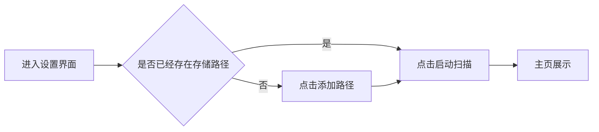

## MVP v1实现目标

## Function TO-DO

| #    | 决策项                               | 结论                                                                                                                                                                                                                                          | 状态               |
| ---- | --------------------------------- | ------------------------------------------------------------------------------------------------------------------------------------------------------------------------------------------------------------------------------------------- | ---------------- |
| D1   | v1 扫描出的 exe 定位                    | **识别信号**——仅用于判定"该目录是否算一个游戏"，exe 路径**不落库**、UI 不展示；v2 做启动功能时再扫一次。 （曾评估"落库候选清单以支撑 v2 的列出让用户选"，经主人裁定**不落库**，见 D19）                                                                                                                           | ✅ 已定（D19 裁定后维持）  |
| D2   | 技术栈                               | **Tauri v2 + Rust 后端 + Web 前端**（主人第四轮明确"接受"）                                                                                                                                                                                                | ✅ 已定（主人确认）       |
| D3   | 数据存储                              | **SQLite**                                                                                                                                                                                                                                  | ✅ 已定             |
| D4   | 前端框架                              | **Vue 3 + TypeScript + Vite**（Tauri 生态模板覆盖最广，出活最快；若变更，影响面仅限前端层，不触后端）                                                                                                                                                                        | ✅ 已定             |
| D5   | 顶层识别单元                            | **智能下探 + 压缩文件即游戏**：仓库根的直接子目录为深度 1；目录**或子目录**内含压缩文件 → 判定为游戏（**压缩包型**）；否则含候选 exe → 判定为游戏（**文件夹型**）；两者皆无 → 视为容器目录继续下探，**最大深度 3**（写死）                                                                                                           | ✅ 已定（主人口径）       |
| D5a  | 游戏类型字段                            | 档案新增 `game_type`（文件夹型 / 压缩包型）——因为 MVPv2 对两者的搬运处理不同                                                                                                                                                                                          | ✅ 已定（主人要求）       |
| D6   | 分卷压缩包                             | **按组分卷聚合为一个条目**（`.part1.rar` / `.zip.001` 等视为同一游戏，档案只录一条）                                                                                                                                                                                   | ✅ 已定             |
| D7   | 扫描并发数                             | 默认 **1–2**（HDD 上并发会因寻道竞争变慢，并非越大越快）                                                                                                                                                                                                          | ✅ 已定（按实现侧推荐）     |
| D8   | 进度条口径                             | 进度条按**顶层条目数**；旁附文字"已发现 N 个 / 当前：XXX"                                                                                                                                                                                                        | ✅ 已定（按实现侧推荐）     |
| D9   | 扫描任务模型                            | **同一时刻仅一个扫描任务运行**；**扫描期间锁定路径编辑**。暂停中的任务**保留在队列**（不释放占位），点击"开始"从断点续扫                                                                                                                                                                         | ✅ 已定（I5 修正后）     |
| D10  | 扫描中断语义（**I5 修正**）                 | **暂停**：停止当前正在处理的游戏、清除其**正在录入**（未提交）的档案、**记录断点**；进度不终止，点击"开始"后重新入队，**从断点继续扫描**。 **取消**：停止当前游戏、清除未提交档案、**终止进度**；点击"开始"后**重新开始扫描**。 **进程退出**：等同取消（作废）                                                                                    | ✅ 已定（主人回执 I5）    |
| D10a | "正在录入的档案"的含义                      | 指**尚未提交进数据库的当前条目草稿**。清除它只影响"当前这一个游戏"的建档，**不影响已提交档案**（含用户手填的名称/编号/封面）                                                                                                                                                                        | ✅ 已定（实现侧澄清）      |
| D11  | 未扫到条目的 UI                         | **灰显保留**（档案仍在主页但变灰、不可点），数据层标记"缺失"                                                                                                                                                                                                           | ✅ 已定             |
| D12  | **基准约束**（主人下达）                    | 本地 `Z:/Game` 可用作调试/测试基准，但**禁止**将其形态认定为标准形态，**不得用作项目的指导量纲** → 任何判定规则/白名单/阈值不得针对它特化，且全部参数保持可配置                                                                                                                                                | ✅ 已定（主人回执补充）     |
| D13  | 判定信号是否扩展到 `.bat` / `.cmd`         | **已裁定：本版不做**。主人自述"搞混了"——bat 决定的是"**什么是启动项**"，而当前讨论的是"**什么是游戏**"，故 bat 留给 v2 处理（v2 的启动候选可优先选 bat）                                                                                                                                            | ✅ 已裁定（主人回执第 3 轮） |
| D14  | 验收标准                              | 主人 2.0 已建 ACC 章节框架；内容待填（实现侧已给草案：规格 §11.2）                                                                                                                                                                                                   | ⏳ 待定（主人自填）       |
| D15  | **多版本处理**（主人回执 2.0 裁定）            | 多版本聚合（"1 个游戏 N 个版本 → 1 条档案"）**需要理解版本号语义、且版本之间可能形态不同（文件夹 / 压缩包）**，v1 **不做**。→ **每个版本各自建一条档案**（即"1 个游戏 2 个版本 = 2 条档案"）。 验收方式：主人手工建立**专测多版本仓库**（非现有 240 游戏仓库），验证不同版本被正确识别并各自建档                                                              | ✅ 已裁定（主人回执 2.0）  |
| D16  | **仓库路径定位**（主人回执 2.0 裁定，含实现侧修正）    | 设置页（仓库管理）暴露三个定位项：**盘符 / IP / 主机名**。**用户必须配置盘符**，IP 与主机名为可选项。 **探测顺序（实测修正）**：盘符 → IP → 主机名，但**必须按"可达性"跳过不可用项**，不可仅按存在性判断（否则盘符残留但已断开时会误判）。全部不可达 → 提示用户检查网络配置。 ⚠️ **实测限制**：含中文的主机名**不能用于 SMB 路径**（见 §1.4），因此"主机名保底"在中文主机名场景下**失效**，需主人知悉 | ✅ 已裁定（待确认修正点）    |
| D17  | **档案粒度**（实现侧澄清，主人确认）              | 档案粒度 = **目录级，不是文件级**。同一目录下的多个 exe、多个压缩包文件 → **归并为 1 条档案**；不同版本目录 → 各自 1 条档案（与 D15 一致）                                                                                                                                                       | ✅ 已澄清            |
| D18  | **排除名单的定位**（由 D15/D17 反推，主人追认并加码） | 排除名单的作用**从"过滤掉目录"降级为"在候选中选择代表"**——只要目录内还有任何 exe，就**必须**建为档案（**绝不因得分不足或全部命中名单而漏档**）。 主人追加要求："**绝对不能漏掉正确的**，但**可以接受误判错误的**" → 已给出不漏档证明（规格 §3.3）                                                                                            | ✅ 已定（主人追认）       |
| D19  | **exe 候选清单是否落库**（Q-O，已裁定）         | **不落库**。D1 保持不变——exe 路径一律不落库。 理由（主人选择最简原则）：v1 无启动功能，无展示需求。**代价**：v2 要"列出 exe 让用户选"时，需**对该游戏目录做一次局部重扫**（单个游戏目录遍历成本很低），或完全依赖用户手选。 主人最终设计意图（"不替用户选，列出让用户选"）由 **v2 承担**                                                                   | ✅ 已裁定（不落库）       |
| D20  | **档案是否带"版本标识"字段**（Q-P，已裁定）        | **不留字段**。v1 档案不含任何版本痕迹（最简）。 **代价**：v2 做多版本聚合时需重新提取版本信息，或通过档案间关系表达                                                                                                                                                                        | ✅ 已裁定（不留）        |

## ACC （验收标准）