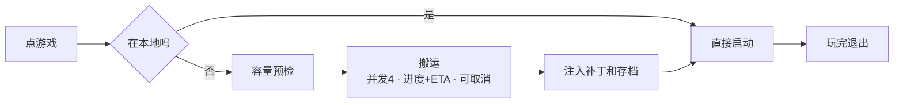

## 1、MVP v2

### 流程图



### 目标

MVP v2将实现从HDD搬运游戏到本地缓存池并启动运行，不做回写数据到变更组

优化UI交互，主要的改动在于卡片样式优化、新增搬运页、多仓库根显示。

优化仓库管理：需要考虑到缓存池存在，而仓库中不存在的游戏。
- 这里的目的在于优化用户体验：用户应当能够直接在本地放置游戏，然后往仓库搬运。如果强制要求先入仓库，再到本地，那么这里会产生不必要的消耗
### 问题

是否要在此步骤加入变更组？

不加入的原因：就单向搬运，不写会仓库而言，当前的设计已经达成了最小闭环，符合mvp需求

加入的原因：变更组掌管存档注入和脚本注入，每次搬运到缓存池的时候都需要进行一遍注入

想了下还是得加入变更组，所以写吧

---

## 2、对象定义


> [!NOTE] 搬运对象
> 依据：MVPv1.1设计规划1.0.md
> 
> 按结构分类：
> - 对于**标准型**，将**版本标识层**作为搬运对象，每次搬运时将直接搬运整个目录
> - 对于**紧凑型**，将**游戏标识层**作为搬运对象，每次搬运时将直接搬运整个目录

> [!NOTE] 游戏本体
> 依据：MVPv1.1设计规划1.0.md
> 
> 在v1.1中定义断言：档案 = 游戏标识层，版本 = 版本标识层。而在实机的标准型布局中，档案下可能存在多个版本；在紧凑型布局中，档案下仅存在唯一版本。此时游戏标识层承担版本标识层的任务，后文统称为版本标识层。
> 
> 因此游戏本体应当等同于没有被拉黑的版本标识层目录下的所有文件，且不同的版本标识层均被认为是不同的游戏本体。

> [!NOTE] 变更组
> 变更组对象包含存档组与补丁组
> 
> 变更组的注入顺序是在于已经完成了游戏搬运到本地后。即先启动游戏搬运，当确认游戏搬运到本地后，再搬运变更组覆写游戏内容
> 
> (待完善)
> 

> [!NOTE] 可执行文件与启动项文件
> 
> 依据：MVPv1.1设计规划1.0.md
> 
> 在v1.1中给出判定：必须存在可执行文件或压缩包，且该文件和压缩包不能存在于子目录中，才认定此时存在一个游戏版本
> 
> 定义这两者含义的目的在于区分**判断版本**和**启动项**。可执行文件属于启动项的一个子对象。
> 
> 可执行文件(Executable File)：可执行文件一定是源自于游戏本体，被约束为仅.exe文件，不包含.bat等非标准意义上的可执行文件。作用是自动判定游戏版本。
> 
> 启动项文件：启动项文件不一定来源于游戏本体，可能来源于变更组的补丁组注入，不局限于.exe文件，还包含.bat等类别的文件。作用是启动游戏进程。

> [!NOTE] 缓存池、游戏仓库、存档组、补丁组
> 
> 缓存池指的是本地游戏运行电脑上的文件目录，外存通常是SSD。缓存池用于装载被选中需要游玩的游戏文件，并注入对应的补丁和存档文件。游戏运行在缓存池中。
> 
> 游戏仓库指的是小主机或NAS端搭载的文件目录，同样被称为游戏根，外存通常是HDD。游戏仓库仅用来静态存储游戏本体并调出到缓存池，为了防止游戏本体被污染，一般情况下禁止回写覆盖操作。
> 
> 存档组指的是用于存储游戏在保存存档后所产生的变更文件的文件目录，可以进行回写、覆盖操作。存储在小主机或NAS端，不存储在本地
> 
> 补丁组指的是需要注入到游戏本体中的补丁文件的文件目录，关于是否可以回写、覆盖，目前待定（收到补丁检测方案的影响）。存储在小主机或NAS端，不存储在本地


例子：

游戏根：Z:/Games/
游戏标识层：RJ123456/、St234567/
版本标识层：RJV1/、RJV2/、RJN/、StV1/、StV2/、StN/

```
标准型
Z:/Games/RJ123456/
├── RJV1/
|   ├── 压缩包.zip1 
|   └── 压缩包.zip2
├── RJV2/
|   └── 可执行文件及各类游戏文件
└── RJN/
	└── 艺术集
	
紧凑型
Z:/Games/St234567/
├── StV1/
|   ├── 压缩包.ra1 
|   └── 压缩包.ra2
├── StV2/
|   └── 可执行文件及各类游戏文件
└── StN/
	├── 压缩包a.zip
	└── 压缩包b.zip
```

当用户第一次扫描时，RJV1/、RJV2/、RJN/、StV1/、StV2/、StN/被认为是不同的游戏本体，不同的搬运目录

用户删除掉了RJN/，此时RJN/不再被视为1个游戏本体和搬运目录。

当用户选择RJV1并点击搬运按钮后，程序将搬运V1目录到缓存池中，然后执行解压操作

当用户选择StV2并点击搬运按钮后，程序将搬运V2目录到缓存池中。由于是文件夹形式，因此不需要执行额外的解压操作

**边界条件：** 在样例的StN中存在两个不同的压缩包文件，如果直接解压缩这两个压缩包文件则可能会产生文件覆盖冲突。
**解决方法：** 在版本界面警告用户文件夹形态不规范并硬阻塞搬运，不允许启动搬运操作直到用户规范并重扫档案