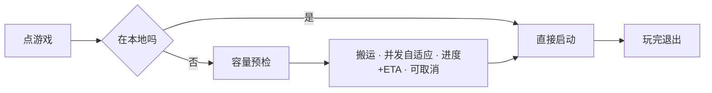

> [!NOTE] 变更内容
> 1、经过讨论，取消对压缩包形态的支持（版本判定不再包含压缩包）
> 2、新增「仓库编号」定义：程序为每个仓库分配的稳定标识，用于缓存池路径分层
> 3、修正紧凑型示例：游戏标识层自身即版本，不再存在 StV1/StV2/StN 此类版本子目录
> 4、删除「用户直接在本地放置游戏并往仓库搬运」的目标描述（v2 不做反向搬运）
> 5、流程图搬运节点改为「并发自适应」，与自动定档规则对齐

## 1、MVP v2

### 流程图



### 目标

MVP v2将实现从HDD搬运游戏到本地缓存池并启动运行，不做回写数据到变更组

优化UI交互，主要的改动在于新增搬运页、多仓库根显示。

v2版本不做变更组的内容，不需要考虑存档的存留问题。存档、变更组维护等到2.1再专门做

---

## 2、对象定义

> [!NOTE] 搬运对象
> 依据：MVPv1.1设计规划1.0.md
> 
> 按结构分类：
> - 对于**标准型**，将**版本标识层**作为搬运对象，每次搬运时将直接搬运整个目录
> - 对于**紧凑型**，将**游戏标识层**作为搬运对象，每次搬运时将直接搬运整个目录

> [!NOTE] 游戏本体
> 依据：MVPv1.1设计规划1.0.md
> 
> 在v1.1中定义断言：档案 = 游戏标识层，版本 = 版本标识层。而在实机的标准型布局中，档案下可能存在多个版本；在紧凑型布局中，档案下仅存在唯一版本。此时游戏标识层承担版本标识层的任务，后文统称为版本标识层。
> 
> 因此游戏本体应当等同于没有被拉黑的版本标识层目录下的所有文件，且不同的版本标识层均被认为是不同的游戏本体。

> [!NOTE] 可执行文件与启动项文件
> 
> 依据：MVPv1.1设计规划1.0.md
> 
> 在v1.1中给出判定：必须存在可执行文件，且该文件不能存在于子目录中，才认定此时存在一个游戏版本
> 
> 定义这两者含义的目的在于区分**判断版本**和**启动项**。可执行文件属于启动项的一个子对象。
> 
> 可执行文件(Executable File)：可执行文件一定是源自于游戏本体，被约束为仅.exe文件，不包含.bat等非标准意义上的可执行文件。作用是自动判定游戏版本。
> 
> 启动项文件：启动项文件不一定来源于游戏本体，可能来源于变更组的注入（v2 暂无注入来源），不局限于.exe文件，还包含.bat等类别的文件。作用是启动游戏进程。

> [!NOTE] 缓存池、游戏仓库
> 
> 缓存池指的是本地游戏运行电脑上的文件目录，外存通常是SSD。缓存池用于装载被选中需要游玩的游戏文件，并注入对应的变更组文件（v2 不注入，属 2.1）。游戏运行在缓存池中。
> 
> 游戏仓库指的是小主机或NAS端搭载的文件目录，同样被称为游戏根，外存通常是HDD。游戏仓库仅用来静态存储游戏本体并调出到缓存池，为了防止游戏本体被污染，一般情况下禁止回写覆盖操作。

> [!NOTE] 仓库编号
> 
> 由于程序支持多仓库配置（同时也鼓励用户使用多仓库进行分类RPG、GAL等），现规定仓库编号的编号规则
> 
> 仓库编号 = 程序为每个仓库分配的稳定标识（使用数据库自增 id，如 `R01`），用于缓存池路径分层；仓库改名不影响编号。id 超过 99 时为 R100，不循环到R01。
> 

例子：

游戏根：Z:/Games/
游戏标识层：RJ123456/、St234567/
版本标识层：RJV1/、RJV2/、RJN/

```
标准型
Z:/Games/RJ123456/
├── RJV1/
|   └── 可执行文件及各类游戏文件
├── RJV2/
|   └── 可执行文件及各类游戏文件
└── RJN/
	└── 艺术集
	
紧凑型
Z:/Games/St234567/
└── St234567的可执行文件及各类游戏文件

```

当用户第一次扫描时，RJV1/RJV2/RJN 是 RJ123456 下的三个版本（三个独立搬运对象）；St234567 作为一个紧凑型档案，自身即一个搬运对象

用户删除掉了RJN/，此时RJN/不再被视为一个版本/搬运对象

当用户选择St234567/并点击搬运按钮后，程序将搬运对象搬运到缓存池中。需要注意的是，紧凑型搬运的位置是：缓存池根/<仓库编号>/St234567/SakuCompact/St234567的可执行文件及各类游戏文件
- 这里的设计考量是缓存池对于用户是透明的，因此并不需要迎合用户使用习惯，而是按照程序标准化设计。
- SakuCompact作为紧凑型的版本层通用占位符，不承担具体含义。理论上重名概率极小