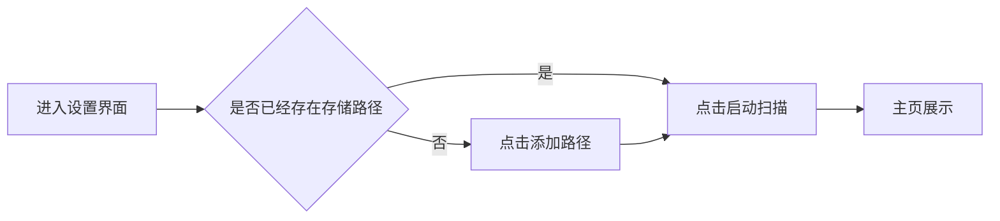
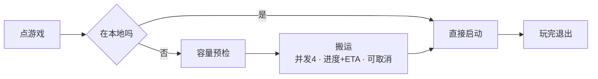

## 1. 硬件约束（已锁定，无需再测）

- NAS 为 **HDD**（总仓库定位，不可能是 SSD），本地运行PC为SSD
- 家宽 500M 下行 / 30–50M 上行（**内网访问不经出口**，非瓶颈）
- 真正瓶颈：**HDD 随机寻道**，升级网口也无法消除
- → **"游戏必须搬到本地SSD跑"是硬约束，只能自动化解决**


## 2. 图表
### MVP v1实现目标 —— 扫描建档


### MVP v2实现目标 —— 开始游玩


### MVP v3实现目标 —— 存储管理
  ```mermaid
flowchart LR
  F[搬运新游戏] --> G{缓存池满?}
  G -- 是 --> H[按 大小×f上次游玩时间 确认淘汰项<br/>锁定项跳过] 
  H --> I[扫描对比<br/>游戏目录 + 手填存档位置]
  I --> J[变更组<br/>存档组/补丁组] --> K[写回 NAS] --> L[清除本地副本]
  L --> G{缓存池满?} -- 是 --> M{通知扩容/解锁}
  M -- 扩容 --> N[开始搬运]
  M -- 解锁 --> I
  G -- 否 --> N
  ```